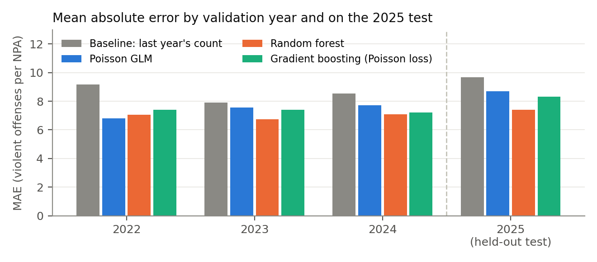
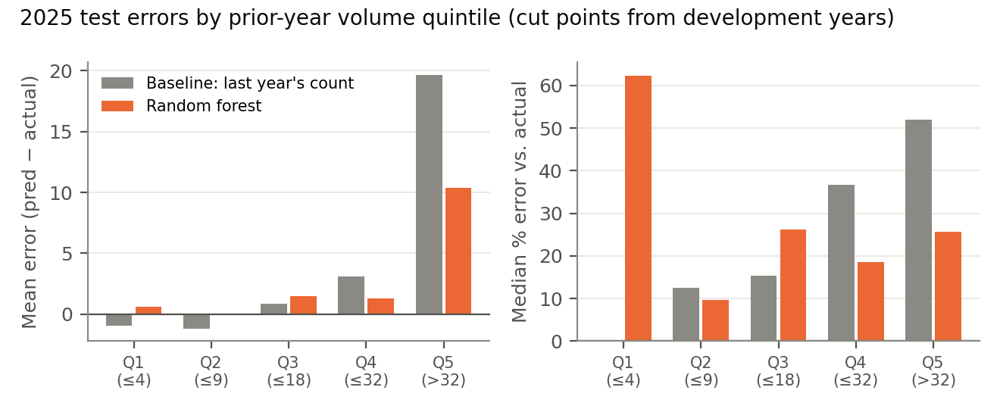

# Rated for Whom? Auditing Neighborhood Safety Scores in Charlotte

**D3 modeling note | November 2026**

## Task, data, and validation design

**Prediction task.** Forecast each Neighborhood Profile Area's (NPA's) reported violent-offense count for the next calendar year using only earlier years. The target is the published summary's broad `Violent Crime` count per NPA-year. It equals the named-offense sum in all 3,887 NPA-years, and the gunshot-injury indicator is excluded. A forecast like this is the raw material of a "safety score," so its error shows how stable such a score would be. It is not a safety rating, and the counts are not rates.

**Rows.** One row is an NPA-year whose own count and prior-year count are both published. Following D2, missing NPA-years are **not** treated as zero, so a row without a prior year is excluded and counted (20–36 per year; 27 in 2025). Development has 2,955 rows (target years 2016–2024). The test year has 316 NPAs.

**Features.** All features come from years before the target: log lags 1–3 with missing-lag flags, a 3-year mean, the historical maximum, the trend (lag 1 − lag 3), years observed, the prior-year citywide total and its change, prior-year gun-assault and robbery shares, and the prior-year gunshot-injury count. An absent injury row gets a "missing" flag, not a zero.

**Validation (identical for every model).** D2's temporal holdout is preserved: 2025 is the test year and 2026 is excluded. Within development years, an expanding-window rolling origin is used. **Tuning folds** (validate 2019, 2020, 2021) select each candidate's hyperparameters from a small grid. **Comparison folds** (validate 2022, 2023, 2024) are kept separate from tuning and compare all four models. Each fold trains on all earlier years. The metrics are MAE (primary), RMSE, mean Poisson deviance, bias (mean predicted − actual), Spearman rank correlation, and top-10% overlap, which is the share of the actual highest-count decile that the model also places in its top decile.

**Selection rule (fixed before 2025 was scored).** Choose the model with the lowest mean comparison-fold MAE. If a simpler model's MAE is within one standard error of that minimum, keep the simpler model (simplicity order: baseline < Poisson GLM < random forest < gradient boosting). Afterwards, every model was refit on all development rows and scored once on 2025.

## Models compared

| Model | Description | Tuned setting |
|---|---|---|
| **Baseline** | Next year = this year's count (persistence) | — |
| **Poisson GLM** | Log-link Poisson regression on standardized features | α = 1.0 |
| **Random forest** | 400 trees fit to log(1 + count), back-transformed | min leaf 5, 50% features |
| **Gradient boosting** | Histogram boosting with Poisson loss, 400 iterations | rate 0.03, 7 leaves |

**Table 1. Comparison folds 2022–2024 (mean across folds) and the single 2025 test.** Lower is better for MAE, RMSE, and deviance. Higher is better for Spearman and top-10% overlap.

| Model | CV MAE (± SE) | CV deviance | CV top-10% | **2025 MAE** | 2025 RMSE | 2025 deviance | 2025 bias | 2025 Spearman | 2025 top-10% |
|---|---|---|---|---|---|---|---|---|---|
| Baseline | 8.54 ± 0.36 | 6.54 | 0.67 | 9.67 | 15.24 | 7.24 | +4.71 | 0.785 | 0.63 |
| Poisson GLM | 7.36 ± 0.28 | **4.34** | 0.75 | 8.71 | 12.36 | 5.88 | +5.90 | **0.830** | 0.66 |
| **Random forest** | **6.96 ± 0.11** | 4.44 | 0.75 | **7.41** | **11.19** | **4.88** | **+2.94** | 0.828 | **0.72** |
| Gradient boosting | 7.35 ± 0.06 | 4.53 | 0.75 | 8.31 | 12.33 | 5.54 | +4.48 | 0.822 | 0.69 |

## Selected model and justification

**The random forest is selected.** In the comparison folds it had the lowest mean MAE (6.96), 18% below the baseline's, and it beat the baseline in all three comparison years (Figure 1). The next-best model, the Poisson GLM (7.36), falls outside one standard error of the forest's MAE (6.96 + 0.11 = 7.07), so the simplicity rule does not override the choice. The evidence is not one-sided. The GLM has slightly lower CV deviance, the three candidates tie on top-10% overlap, and all three candidates are close together compared with the baseline. The gain over persistence therefore comes mostly from using several years of history rather than from the forest itself. On the 2025 test, which played no part in selection, the forest ranked first on MAE, RMSE, deviance, bias, and top-10% overlap. Its test MAE (7.41) is close to its CV estimate, but all models were worse in 2025 than in development, for the reason below.

**Figure 1. MAE by comparison fold and on the held-out 2025 test.** The forest is lowest in two of three comparison folds and in 2025. Every model's error rises in 2025.

## Error analysis

**A citywide drop in 2025 explains most of the test bias.** The summary's citywide total fell from 7,397 (2024) to 5,824 (2025), a 21% drop, while the development folds showed changes of only a few percent. All models over-predicted 2025 (bias +2.9 to +5.9 per NPA). In 148 of 316 NPAs (47%) the count fell by more than 25%. In the comparison folds, falls and rises above 25% were about equally common (331 vs. 326 NPA-years). A diagnostic that rescales each model's 2025 predictions to the true citywide total uses information unavailable at forecast time, but it shows how the error divides. The forest's MAE falls from 7.41 to 6.61, so roughly 11% of its error is the citywide level and the rest comes from how counts are spread across NPAs. For the baseline, the share is 18% (9.67 to 7.88).

**Error grows with prior-year volume (Figure 2).** In the highest prior-volume quintile (more than 32 offenses the year before), 2025 bias was +10.4 for the forest and +19.7 for the baseline, and MAE was 14.4 and 22.3. The 2025 decline was concentrated in high-count NPAs. The forest shrinks extreme counts toward typical values, which cut this over-prediction roughly in half. The same shrinkage costs accuracy at the low end. For NPAs with 4 or fewer offenses the year before, the forest's median over-prediction was 62% (a few offenses), while persistence had a median error of zero there. Shrinkage also cuts the other way at the top: NPA 123 fell from 156 to 110, yet the forest predicted 76. A tree model cannot follow a few extreme NPAs closely.

**Persistence wins when nothing changes.** For NPAs whose 2025 count stayed within ±25% of 2024 (n = 94), the baseline's MAE (3.45) beat the forest's (4.64). The forest's advantage comes entirely from NPAs that moved. Sharp rises are still under-predicted, as with NPA 155 (20 → 60) and NPA 295 (16 → 47). Nothing in an NPA's lagged history anticipates them.

**Who would a score flag?** Of the 32 NPAs in the actual 2025 top decile, the forest placed 23 in its own top decile. It missed 9 and flagged 9 others in their place. Persistence matched 20 of 32. Even the best model therefore changes the "highest-count" list by about a quarter to a third from one year to the next. That is direct evidence for this project's question: a top-10% safety label based on one year's reported counts is partly noise.

**Figure 2. 2025 test errors by prior-year volume quintile.** Quintile cut points (4, 9, 18, and 32 offenses) come from development years only. The forest halves the over-prediction among the highest-count NPAs but over-predicts the smallest ones in relative terms.

**Sensitivity check on the second source.** The same pipeline, with folds and metrics unchanged, was run on CMPD incident-report counts. There the selection rule chose the **baseline**. Persistence had the lowest MAE in every comparison fold (CV MAE 27.1, against 31.9–36.3 for the candidates), and Spearman rank correlation was about 0.98 for every model. CMPD report volume is stable enough from year to year that model complexity adds error. The two tree models also produced large errors on a few very high-volume NPAs (RMSE 94 and 142 vs. 46 in 2025). The two sources call for different choices, which is one more reason D2 kept them separate.

## Limitations

- **Counts, not risk.** No population or exposure denominators exist in the repository, so a high forecast can reflect size, activity, reporting, or enforcement. A model trained on reported counts reproduces those patterns. Using it to direct attention could reinforce them.
- **Rows are conditional on publication.** Zero or unpublished NPA-years are absent rather than set to zero, so the models apply only to NPAs that appear in consecutive years. The 27 NPAs excluded in 2025 are not evaluated, and the low-count end of the distribution is under-represented.
- **2025 may not be comparable.** The 21% drop could be a real decline or a difference in source completeness, and this extract cannot tell which. If 2025 is incomplete, test-year bias is overstated. NPA boundary vintage also remains unverified.
- **Small validation sample.** Only three comparison folds were available, so the standard errors are rough. The tuning folds include the 2020 shift, and the hyperparameter grids were small. Results come from one random seed.
- **Lagged history only.** No features cover land use, population change, or events. Annual aggregates hide seasonality, and the monthly and incident-level files are not in the repository.

**Reproduce:** `python d3_modeling/evaluate_models.py` (about 30 seconds). It writes per-fold metrics, test metrics, grouped error tables, predictions, and figures to `d3_modeling/results/`. The script reads only the two committed NPA-year aggregate CSVs.
